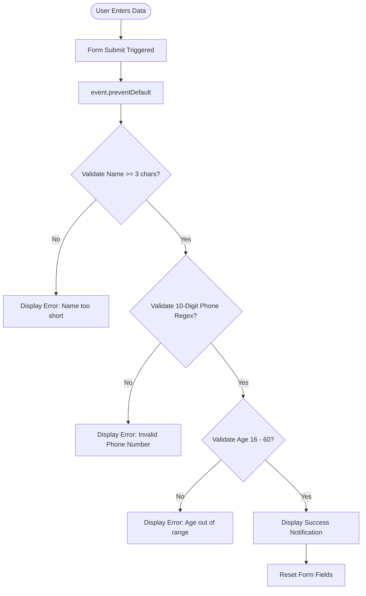

# Practical 01: Responsive Webpage with Form Input Validation

**Course:** BCA (Bachelor of Computer Applications)  
**Subject:** Web Application Development Lab  
**Affiliation:** Maharshi Dayanand University (MDU Rohtak)  

---

## 1. Objective
To design and implement a responsive webpage featuring an interactive user registration form with comprehensive client-side input validation using HTML5, CSS3, and modern JavaScript.

---

## 2. Theoretical Background
Client-side input validation is the initial line of defense in modern web applications. It provides immediate feedback to users, improves user experience (UX) by preventing unnecessary HTTP roundtrips, and ensures that submitted data adheres to expected formats before being processed or transmitted.

### Key Validation Criteria Implemented:
1. **Full Name:** Minimum 3 alphabetical characters (ensures non-empty and realistic input).
2. **Email Address:** Standard RFC 5322 compliant email pattern validation via HTML5 `type="email"`.
3. **Phone Number:** Strict 10-digit numeric format verified via Regular Expression (`^[0-9]{10}$`).
4. **Age Limit:** Numeric constraint between 16 and 60 years using boundary checks.

---

## 3. Architecture & Data Flow



---

## 4. File Structure
```
Program-1/
├── index.html       # Semantic HTML5 markup with accessible attributes
├── style.css        # Responsive CSS layout using Flexbox and Media Queries
├── script.js       # Client-side validation logic and DOM manipulation
└── README.md        # Comprehensive academic documentation
```

---

## 5. Implementation Details

### HTML (`index.html`)
- Utilizes `<meta name="viewport" content="width=device-width, initial-scale=1.0">` for fluid mobile scaling.
- Leverages native HTML5 validation constraints: `required`, `minlength="3"`, `pattern="[0-9]{10}"`, `min="16"`, `max="60"`.

### CSS (`style.css`)
- Centered container layout using modern box-sizing reset (`box-sizing: border-box`).
- Responsive breakpoint at `max-width: 480px` ensuring smooth mobile and handheld usability.
- High-contrast visual focus indicators (`input:focus { border-color: #2563eb; }`).

### JavaScript (`script.js`)
- Intercepts form submission via `event.preventDefault()` to stop default page reload.
- Performs regex evaluation using `/^[0-9]{10}$/.test(phone)`.
- Updates DOM `#message` element dynamically with appropriate status color coding (green for success, red for errors).

---

## 6. How to Run the Program

1. Navigate to the `Program-1` directory.
2. Open `index.html` directly in any standard web browser (Chrome, Firefox, Edge, Safari):
   ```bash
   # Using terminal/powershell (Windows)
   start index.html
   ```
3. Alternatively, launch via the Master Root Single Page Application.

---

## 7. Test Cases & Verification

| Test Case | Name Input | Email Input | Phone Input | Age Input | Expected Result |
| :--- | :--- | :--- | :--- | :--- | :--- |
| **TC-01 (Valid)** | `Amit Kumar` | `amit@mdu.ac.in` | `9876543210` | `21` | "Registration submitted successfully!" (Green) |
| **TC-02 (Short Name)**| `Al` | `al@gmail.com` | `9876543210` | `22` | "Name must contain at least 3 characters." (Red) |
| **TC-03 (Invalid Phone)**| `Rahul Verma` | `rahul@gmail.com` | `98765abcde` | `20` | Browser pattern validation triggers / Custom error |
| **TC-04 (Age Under 16)**| `Priya Sharma`| `priya@gmail.com` | `9123456789` | `14` | "Age must be between 16 and 60." (Red) |

---

## 8. Viva Voce Questions & Answers

**Q1: Why is client-side validation alone not sufficient for secure web applications?**  
*Answer:* Client-side validation can easily be bypassed by disabling JavaScript in the browser or sending direct HTTP requests using tools like Postman or cURL. Therefore, server-side validation is mandatory for security, while client-side validation is primarily for user experience and immediate feedback.

**Q2: What is the purpose of `event.preventDefault()` in form handling?**  
*Answer:* By default, submitting an HTML form initiates an HTTP GET or POST request causing the browser to reload the page. `event.preventDefault()` stops this default behavior, allowing JavaScript to validate inputs and process submissions asynchronously.

**Q3: How does regex pattern `^[0-9]{10}$` work?**  
*Answer:* The `^` asserts the start of the string, `[0-9]` matches any digit from 0 to 9, `{10}` ensures exactly 10 occurrences, and `$` asserts the end of the string. This guarantees exactly ten digits without letters or spaces.
