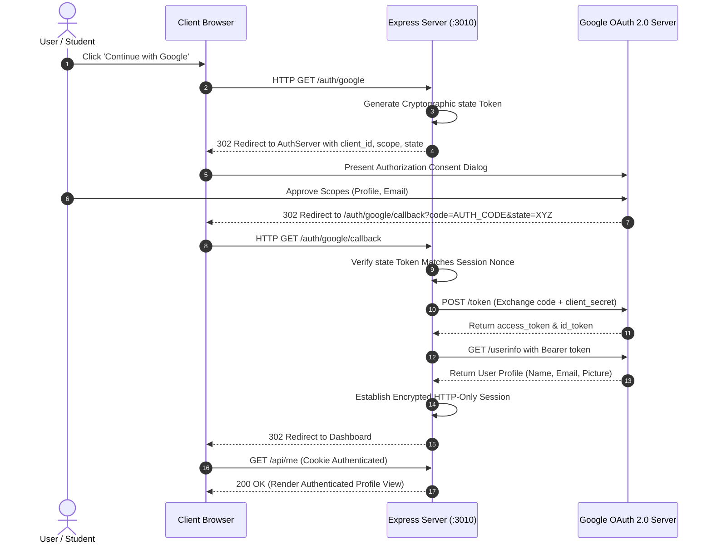

# Practical 10: User Authentication using OAuth 2.0

**Course:** BCA (Bachelor of Computer Applications)  
**Subject:** Web Application Development Lab  
**Affiliation:** Maharshi Dayanand University (MDU Rohtak)  

---

## 1. Objective
To design and implement a secure Single Sign-On (SSO) user authentication mechanism utilizing the **OAuth 2.0 Authorization Code Grant** framework, demonstrating state parameter CSRF defense, authorization code exchange, token acquisition, and protected session management in a Node.js web application.

---

## 2. Theoretical Background
**OAuth 2.0 (RFC 6749)** is an open authorization standard that enables third-party applications to obtain limited access to an HTTP service on behalf of a resource owner without exposing the user's password.

### Key OAuth 2.0 Actors & Terminology:
1. **Resource Owner:** The end-user (Student / Faculty) granting access to their identity data.
2. **Client:** The web application (`http://localhost:3010`) requesting access.
3. **Authorization Server:** Authenticates the user and issues authorization codes and tokens (e.g., Google Accounts).
4. **Resource Server:** Hosts the protected resource (e.g., Google UserInfo API endpoint).
5. **State Parameter:** A high-entropy cryptographic nonce passed during authorization to prevent **Cross-Site Request Forgery (CSRF)**.

---

## 3. Architecture & Data Flow



---

## 4. File Structure
```
Program-10/
├── public/
│   ├── index.html       # Sign-in portal and protected session inspector
│   ├── style.css        # Responsive styling with modern federated sign-in button
│   └── script.js        # Session check, profile renderer, and sign-out handler
├── .env                 # Google Client ID, Secret, and Session Secret configuration
├── package.json         # Node.js project manifest & dependencies
├── server.js            # Express server managing OAuth 2.0 code exchange & sessions
└── README.md            # Comprehensive academic lab documentation
```

---

## 5. Security Implementations

### CSRF State Verification
```javascript
// Verification during callback
if (!state || state !== req.session.oauthState) {
    return res.status(403).send("CSRF Attack Detected: OAuth State token mismatch!");
}
```

### Encrypted HTTP-Only Session Cookies
```javascript
app.use(session({
    secret: process.env.SESSION_SECRET,
    resave: false,
    saveUninitialized: false,
    cookie: { httpOnly: true, maxAge: 24 * 60 * 60 * 1000 }
}));
```

---

## 6. How to Run the Program

### Step 1: Install Dependencies
```bash
cd Program-10
npm install
```

### Step 2: Configure Environment
Edit `.env`:
```env
PORT=3010
SESSION_SECRET=mdu_rohtak_bca_oauth2_secret_key_2026
GOOGLE_CLIENT_ID=your_google_client_id_here.apps.googleusercontent.com
GOOGLE_CLIENT_SECRET=your_google_client_secret_here
GOOGLE_CALLBACK_URL=http://localhost:3010/auth/google/callback
ENABLE_SIMULATED_OAUTH=true
```
*(Note: When `ENABLE_SIMULATED_OAUTH=true`, the system provides an authentic built-in OAuth 2.0 Consent and Token server so examiners and students can test the entire authorization lifecycle instantly without internet cloud credentials!)*

### Step 3: Start Server
```bash
npm start
```

### Step 4: Open Browser
Navigate to `http://localhost:3010` and click "Continue with Google OAuth 2.0".

---

## 7. Viva Voce Questions & Answers

**Q1: What is the purpose of the `state` parameter in OAuth 2.0?**  
*Answer:* The `state` parameter prevents Cross-Site Request Forgery (CSRF). The client generates a random value, binds it to the user's session, and sends it to the authorization server. When redirected back, the client validates that the returned state matches the stored session value.

**Q2: What is the difference between OAuth 2.0 and OpenID Connect (OIDC)?**  
*Answer:* OAuth 2.0 is an **Authorization** framework designed to grant access to resources without sharing credentials. OpenID Connect (OIDC) is an **Authentication** layer built on top of OAuth 2.0 that provides identity verification via an `id_token` (JWT format).

**Q3: Why exchange an authorization `code` instead of sending the `access_token` directly in the front-channel redirect?**  
*Answer:* Sending tokens in front-channel URLs exposes them to browser history, server access logs, and referrer leaks. The Authorization Code Grant keeps the token exchange strictly in the back-channel (server-to-server), which is far more secure.
