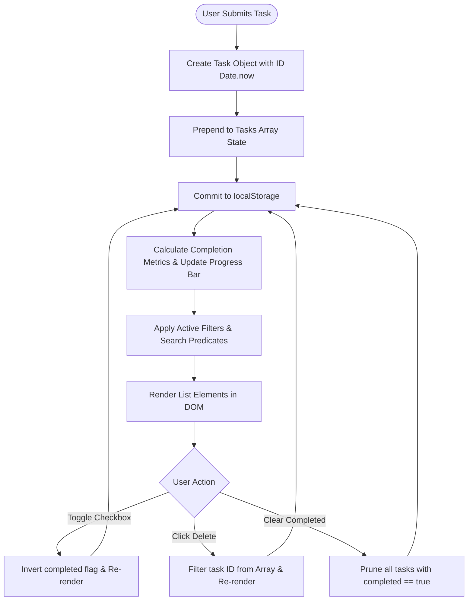

# Practical 11: Dynamic To-Do List Web Application

**Course:** BCA (Bachelor of Computer Applications)  
**Subject:** Web Application Development Lab  
**Affiliation:** Maharshi Dayanand University (MDU Rohtak)  

---

## 1. Objective
To construct an interactive To-Do list productivity web application enabling users to add, filter, search, complete, and delete tasks while maintaining persistent synchronization with the browser's `localStorage` and computing real-time task completion statistics.

---

## 2. Theoretical Background
Task management applications require robust **state-driven architecture**. In this system:
1. **Model:** Array of task objects containing `{ id, title, category, priority, dueDate, completed }`.
2. **Persistence:** Serialized JSON representation written to the browser's persistent key-value Web Storage engine (`localStorage`).
3. **State Derivation:** The application dynamically calculates the completion percentage:
   $$\text{Completion Rate} = \left(\frac{\text{Completed Tasks}}{\text{Total Tasks}}\right) \times 100\%$$
4. **Declarative Rendering:** The DOM updates automatically based on filtering predicates (`all`, `active`, `completed`) and instant search queries.

---

## 3. Architecture & Data Flow



---

## 4. File Structure
```
Program-11/
├── index.html       # Task creation form, metrics bar, filter tabs, and list view
├── style.css        # Responsive styling with priority badges and animations
├── script.js        # State manager, LocalStorage persistence, progress calculator
└── README.md        # Comprehensive academic lab documentation
```

---

## 5. Implementation Walkthrough

### 1. Persistent Storage Operations
```javascript
function saveTasks() {
    localStorage.setItem(STORAGE_KEY, JSON.stringify(tasks));
    updateProgress();
    renderTasks();
}
```

### 2. Multi-Criteria Task Filtering
```javascript
const filtered = tasks.filter(task => {
    const matchesFilter = (currentFilter === "all") ||
        (currentFilter === "active" && !task.completed) ||
        (currentFilter === "completed" && task.completed);
    const matchesSearch = !searchQuery || 
        task.title.toLowerCase().includes(searchQuery) ||
        task.category.toLowerCase().includes(searchQuery);
    return matchesFilter && matchesSearch;
});
```

---

## 6. How to Run the Program
1. Open the `Program-11` folder.
2. Launch `index.html` in any web browser.
3. Add academic tasks with priorities and deadlines.
4. Toggle completion checkboxes to watch the animated progress bar update in real time.
5. Close or refresh the tab to confirm data persistence.

---

## 7. Viva Voce Questions & Answers

**Q1: What are the key advantages of using `localStorage` over cookies for client-side storage?**  
*Answer:* `localStorage` provides greater capacity (~5MB-10MB vs 4KB), does not transmit stored data in HTTP request headers (reducing network payload overhead), and offers a simpler key-value API (`getItem`, `setItem`).

**Q2: What is the significance of using `Date.now()` as a unique identifier for tasks?**  
*Answer:* `Date.now()` returns the number of milliseconds elapsed since January 1, 1970 (Unix epoch). In single-user client-side applications, it generates practically guaranteed unique integer IDs for created items.

**Q3: How do you prevent XSS attacks when displaying user-entered task titles?**  
*Answer:* By either using `textContent` when assigning text to DOM nodes, or encoding user-supplied text through an HTML entity escaping helper (`escapeHtml()`) before injecting into templates.
