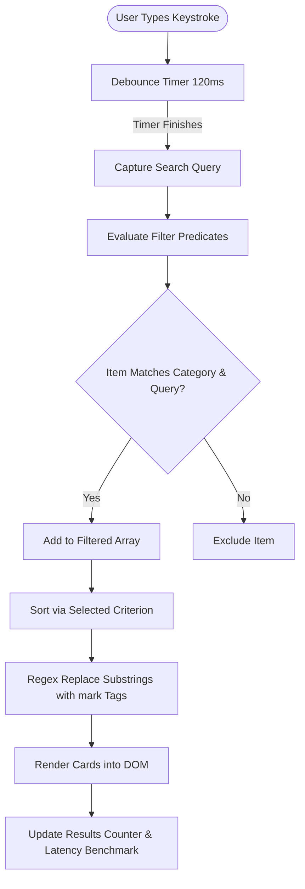

# Practical 12: Real-Time Search & Dynamic Filtering

**Course:** BCA (Bachelor of Computer Applications)  
**Subject:** Web Application Development Lab  
**Affiliation:** Maharshi Dayanand University (MDU Rohtak)  

---

## 1. Objective
To design and implement a high-performance, real-time client-side search and filtering engine with input debouncing, multi-criteria category filtering, dynamic sorting, and substring match highlighting using modern JavaScript.

---

## 2. Theoretical Background
Real-time search enhances user discoverability across large datasets. However, naive implementations that execute search filtering on every raw keystroke can degrade responsiveness.

### Algorithmic Highlights:
1. **Debouncing Technique:**
   Debouncing enforces that a function will not be executed until a certain amount of time has passed since it was last called.
   ```javascript
   function debounce(func, wait) {
       let timeout;
       return (...args) => {
           clearTimeout(timeout);
           timeout = setTimeout(() => func.apply(this, args), wait);
       };
   }
   ```
2. **Dynamic Substring Highlighting:**
   Matches between the user's search token and item attributes are wrapped with HTML5 `<mark>` elements using regular expressions, while ensuring special characters are escaped to prevent DOM injection vulnerabilities.
3. **Compound Filtering:**
   Applies multiple conjunction predicates ($P_1 \land P_2 \land P_3$) across Department, Academic Level, and Keyword matching.

---

## 3. Architecture & Data Flow



---

## 4. File Structure
```
Program-12/
├── index.html       # Search bar, filter dropdowns, chips, and results grid
├── style.css        # Responsive styling with mark highlights and card hover
├── script.js        # Debounce controller, regex highlighter, filter logic
└── README.md        # Comprehensive academic lab documentation
```

---

## 5. Implementation Walkthrough

### 1. Regex Substring Match Highlighting
```javascript
function highlightMatch(text, query) {
    if (!query) return escapeHtml(text);
    const escapedQuery = query.replace(/[.*+?^${}()|[\]\\]/g, "\\$&");
    const regex = new RegExp(`(${escapedQuery})`, "gi");
    return escapeHtml(text).replace(regex, '<mark class="highlight">$1</mark>');
}
```

### 2. Performance Tracking
The filter routine benchmarks execution duration using the browser's High Resolution Time API (`performance.now()`), displaying sub-millisecond latency badges to verify optimal performance.

---

## 6. How to Run the Program
1. Open folder `Program-12`.
2. Launch `index.html` in your web browser.
3. Type keywords such as `Java`, `React`, `Data`, or `SQL`.
4. Observe instantaneous substring highlighting across titles and descriptions.
5. Combine filters with Department dropdowns and Sort criteria.

---

## 7. Viva Voce Questions & Answers

**Q1: What is the distinction between Debouncing and Throttling?**  
*Answer:* **Debouncing** delays the execution of a function until a specific period of inactivity has elapsed since the last trigger (ideal for search input). **Throttling** guarantees that a function is executed at most once within a specified time interval (ideal for window resize and scroll events).

**Q2: Why must special regex characters be escaped when building dynamic `RegExp` objects?**  
*Answer:* Characters like `*`, `+`, `?`, `^`, `[`, and `(` have special syntactic meanings in regular expressions. If a user inputs these characters without escaping, an unhandled `SyntaxError` will crash the search filter.

**Q3: How does client-side search compare with server-side database search?**  
*Answer:* Client-side search offers near-zero latency and offline capability for small-to-medium datasets (< 50,000 items). Server-side search (using SQL `LIKE` or Elasticsearch) is required for massive datasets that exceed browser memory limits.
