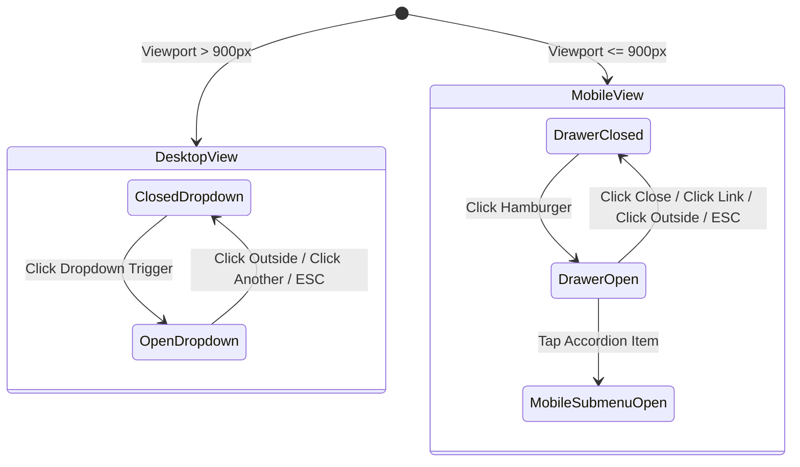

# Practical 13: Responsive Navigation Menu with Dropdowns

**Course:** BCA (Bachelor of Computer Applications)  
**Subject:** Web Application Development Lab  
**Affiliation:** Maharshi Dayanand University (MDU Rohtak)  

---

## 1. Objective
To design and construct a fully responsive, accessible, multi-tiered navigation bar featuring nested dropdown menus, an off-canvas mobile hamburger drawer, smooth CSS transitions, and comprehensive keyboard/ARIA accessibility using HTML5, CSS3, and JavaScript.

---

## 2. Theoretical Background
The navigation system is the primary architectural backbone of any website. Key design criteria include:
- **Responsive Fluidity:** Adapts from a multi-column desktop header to a slide-in off-canvas drawer on narrow viewports (`max-width: 900px`).
- **WCAG 2.1 Accessibility:**
  - `role="menubar"`, `role="menuitem"`, `aria-haspopup="true"`.
  - Dynamic `aria-expanded="true/false"` state updates.
  - Keyboard dismissal via the `Escape` key.
- **Accordion Dropdown Behavior:** Automatically collapses sibling dropdown menus when a new one is selected to prevent visual clutter.
- **Click-Outside Dismissal:** Listens on the global document tree to collapse active flyouts when user focus shifts elsewhere.

---

## 3. Architecture & Data Flow



---

## 4. File Structure
```
Program-13/
├── index.html       # Semantic HTML5 header, navigation list, ARIA attributes
├── style.css        # Responsive Flexbox, off-canvas transitions, hamburger morph
├── script.js        # Mobile toggle controller, accordion logic, click-outside
└── README.md        # Comprehensive academic lab documentation
```

---

## 5. Implementation Walkthrough

### 1. Click-Outside Event Delegation
```javascript
document.addEventListener("click", (e) => {
    if (!navMenu.contains(e.target) && !hamburgerBtn.contains(e.target)) {
        closeAllDropdowns();
        closeMobileMenu();
    }
});
```

### 2. Animated Hamburger Transformation (CSS)
```css
.hamburger-btn.active .bar:nth-child(1) {
    transform: rotate(45deg) translate(8px, 8px);
}
.hamburger-btn.active .bar:nth-child(2) { opacity: 0; }
.hamburger-btn.active .bar:nth-child(3) {
    transform: rotate(-45deg) translate(7px, -7px);
}
```

---

## 6. How to Run the Program
1. Navigate to folder `Program-13`.
2. Open `index.html` in your web browser.
3. Test dropdown menus in full desktop mode.
4. Resize browser width below 900px (or toggle Device Mode in Chrome DevTools) to test the mobile hamburger drawer and touch accordions.
5. Press the `Escape` key to test accessible dismissal.

---

## 7. Viva Voce Questions & Answers

**Q1: What is the purpose of `aria-haspopup` and `aria-expanded` attributes?**  
*Answer:* These ARIA attributes communicate menu state to assistive technologies like screen readers. `aria-haspopup="true"` alerts the user that clicking the element opens a submenu, and `aria-expanded="true/false"` indicates whether that submenu is currently visible.

**Q2: Why should `e.stopPropagation()` be used cautiously in dropdown menus?**  
*Answer:* `e.stopPropagation()` prevents the click event from bubbling up the DOM tree to document-level listeners. While it prevents immediate dismissal when clicking inside the dropdown, it must not block legitimate navigation links from firing.

**Q3: How do CSS media queries differentiate between mobile and desktop styles?**  
*Answer:* Using `@media (max-width: 900px)`, the CSS engine conditionally applies rules based on the client viewport dimensions, transforming fixed-position menus into flexible off-canvas drawers without changing the underlying HTML markup.
