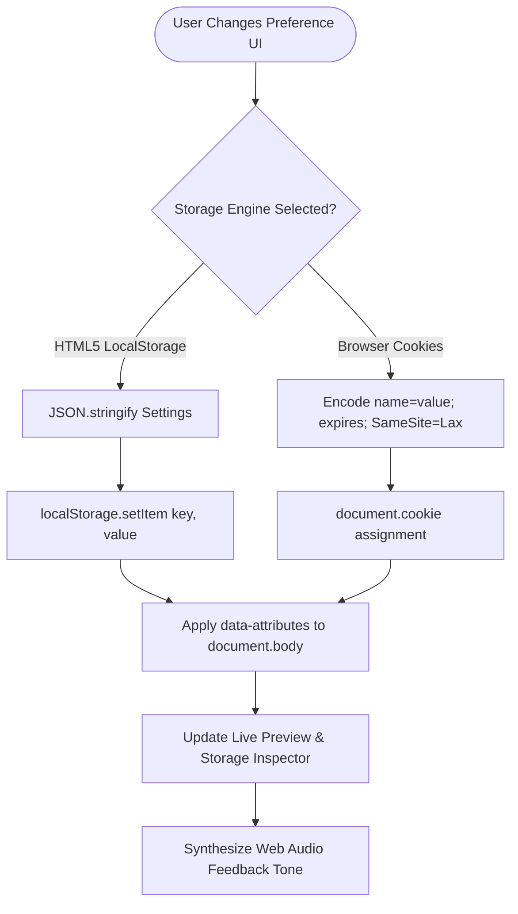

# Practical 14: User Preferences Storage via Cookies & LocalStorage

**Course:** BCA (Bachelor of Computer Applications)  
**Subject:** Web Application Development Lab  
**Affiliation:** Maharshi Dayanand University (MDU Rohtak)  

---

## 1. Objective
To implement, compare, and analyze client-side persistence strategies by constructing a User Preferences Dashboard that stores user settings (theme, typography scale, layout density, language, and audio effects) using both **Browser Cookies** and **HTML5 `localStorage`**.

---

## 2. Theoretical Background & Comparison

| Feature | Browser Cookies (`document.cookie`) | HTML5 Web Storage (`localStorage`) |
| :--- | :--- | :--- |
| **Capacity** | ~4 Kilobytes per cookie | ~5 to 10 Megabytes per origin |
| **Data Transmission** | Automatically included in every HTTP request header | Purely client-side; never sent over network |
| **Lifespan** | Configurable via `Expires` / `Max-Age` (or session) | Persistent indefinitely until explicitly cleared |
| **API Usability** | Raw string parsing required (`name=val; expires=...`) | Clean Key-Value interface (`getItem`, `setItem`) |
| **Security Attributes**| `HttpOnly`, `Secure`, `SameSite=Lax/Strict` | Sandboxed per origin (accessible via JavaScript) |

---

## 3. Architecture & Data Flow



---

## 4. File Structure
```
Program-14/
├── index.html       # Preference selectors, live preview sandbox, raw storage inspector
├── style.css        # Dynamic CSS variable system using data-attributes for themes & fonts
├── script.js        # Cookie parsing/setting functions, LocalStorage manager, Web Audio API
└── README.md        # Comprehensive academic lab documentation
```

---

## 5. Implementation Walkthrough

### 1. Robust Cookie Setting Function
```javascript
function setCookie(name, value, days = 30) {
    const date = new Date();
    date.setTime(date.getTime() + (days * 24 * 60 * 60 * 1000));
    const expires = "expires=" + date.toUTCString();
    document.cookie = `${encodeURIComponent(name)}=${encodeURIComponent(value)};${expires};path=/;SameSite=Lax`;
}
```

### 2. Dynamic CSS Custom Property Theming
Theme, font sizing, and density alterations are applied via `data-` attributes on `document.body`, which dynamically remap CSS variables:
```css
body[data-theme="dark"] {
    --bg-main: #0f172a;
    --bg-card: #1e293b;
    --text-main: #f1f5f9;
}
```

---

## 6. How to Run the Program
1. Navigate to folder `Program-14`.
2. Open `index.html` in your web browser.
3. Toggle between themes (Dark, Sepia, Cyberpunk) and observe instant CSS variable re-binding.
4. Switch storage engine between LocalStorage and Cookies.
5. Inspect the live **Raw Storage Data Inspector** to view exact encoded cookies and serialized JSON keys.

---

## 7. Viva Voce Questions & Answers

**Q1: What are `SameSite` cookie attributes and why are they important?**  
*Answer:* `SameSite` controls whether cookies are sent with cross-site requests. `SameSite=Strict` prevents cookies from being sent in all cross-site browsing contexts; `SameSite=Lax` permits sending with top-level navigations. This provides robust defense against **Cross-Site Request Forgery (CSRF)**.

**Q2: What is the limitation of storing large JSON objects in cookies?**  
*Answer:* Cookies are limited to 4096 bytes per cookie, and are appended to the HTTP `Cookie` header on every single request (images, styles, APIs). Storing large JSON objects bloats HTTP headers and wastes bandwidth.

**Q3: Can client-side JavaScript access cookies marked with `HttpOnly`?**  
*Answer:* No. Cookies with the `HttpOnly` flag cannot be accessed via `document.cookie`. This prevents session tokens from being stolen through Cross-Site Scripting (XSS) attacks.
