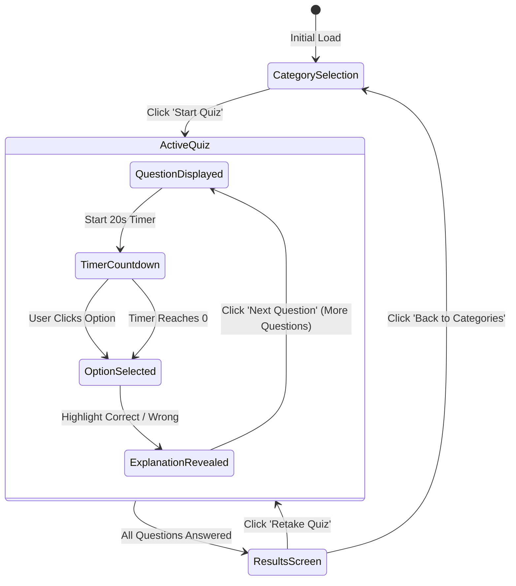

# Practical 15: Dynamic Quiz Web Application with Score Tracking

**Course:** BCA (Bachelor of Computer Applications)  
**Subject:** Web Application Development Lab  
**Affiliation:** Maharshi Dayanand University (MDU Rohtak)  

---

## 1. Objective
To design and develop an interactive, dynamic multiple-choice quiz assessment web application that presents domain-specific questions, enforces per-question countdown timers, calculates immediate grading and analytics, provides rational explanations for every answer, and persists high scores in the browser's `localStorage`.

---

## 2. Theoretical Background
Interactive online testing platforms are state machines that cycle through sequential stages:
1. **Configuration Stage:** Category selection and leaderboard inspection.
2. **Assessment Stage:**
   - Active countdown timer per question using `setInterval()`.
   - Option locking on selection to prevent race conditions or duplicate clicks.
   - Immediate feedback styling (green for correct option, red for incorrect chosen option).
   - Instant pedagogical explanation for educational reinforcement.
3. **Evaluation Stage:**
   - Score percentage calculation:
     $$\text{Score \%} = \left(\frac{\text{Correct Answers}}{\text{Total Questions}}\right) \times 100\%$$
   - Grade assignment (Distinction, High Proficiency, Needs Revision).
   - Comprehensive audit review of every question and student choice.
   - Leaderboard synchronization with `localStorage`.

---

## 3. Architecture & Data Flow



---

## 4. File Structure
```
Program-15/
├── index.html       # Category picker, question card with timer, score report, review
├── style.css        # Responsive layout with animated timers and option badges
├── script.js        # Question data, timer interval, score analytics, LocalStorage
└── README.md        # Comprehensive academic lab documentation
```

---

## 5. Implementation Walkthrough

### 1. Per-Question Countdown Interval
```javascript
timerInterval = setInterval(() => {
    timerSeconds--;
    timerSecondsEl.textContent = timerSeconds;
    if (timerSeconds <= 5) timerBadge.classList.add("urgent");
    if (timerSeconds <= 0) {
        clearInterval(timerInterval);
        handleOptionSelect(-1); // Auto-timeout
    }
}, 1000);
```

### 2. High Score Leaderboard Persistence
```javascript
function saveScore(pct, duration) {
    const list = getLeaderboard();
    list.unshift({ category: selectedCategory.toUpperCase(), score: pct, duration: `${duration}s`, date: new Date().toLocaleDateString() });
    localStorage.setItem(LEADERBOARD_KEY, JSON.stringify(list.slice(0, 5)));
}
```

---

## 6. How to Run the Program
1. Navigate to folder `Program-15`.
2. Open `index.html` in any web browser.
3. Select an academic category (Web Development, DBMS, Operating Systems).
4. Answer the multiple-choice questions within the 20-second countdown.
5. Review detailed feedback, final grade score, and check the updated leaderboard.

---

## 7. Viva Voce Questions & Answers

**Q1: How do you prevent memory leaks when using `setInterval()` in JavaScript?**  
*Answer:* Every `setInterval()` call returns an interval ID. When transitioning between questions, pausing, or completing the quiz, `clearInterval(timerInterval)` must be invoked to stop the timer from continuing to fire in the background.

**Q2: Why is it crucial to disable all option buttons immediately after an answer is submitted?**  
*Answer:* Disabling buttons prevents the user from clicking multiple options or clicking repeatedly, which would cause duplicate score increments and corrupt state tracking.

**Q3: How are arrays and objects serialized for storage in `localStorage`?**  
*Answer:* `localStorage` only stores strings. Objects and arrays must be serialized into JSON strings using `JSON.stringify(data)` before writing, and parsed back into JavaScript objects using `JSON.parse(string)` when reading.
