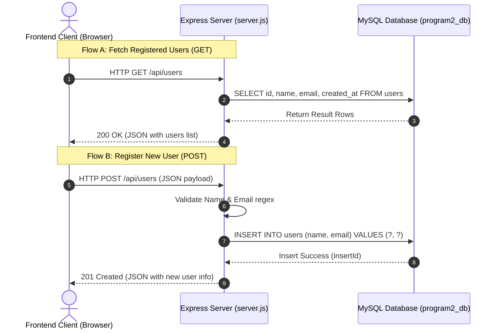

# Practical 02: REST API with Node.js, Express, and MySQL (GET & POST)

**Course:** BCA (Bachelor of Computer Applications)  
**Subject:** Web Application Development Lab  
**Affiliation:** Maharshi Dayanand University (MDU Rohtak)  

---

## 1. Objective
To construct a RESTful API service using Node.js and Express that handles `GET` and `POST` requests, connects to a MySQL relational database via a connection pool, and serves an interactive web interface.

---

## 2. Theoretical Background
**Representational State Transfer (REST)** is an architectural style for network-based hypermedia systems. Key constraints include:
- **Statelessness:** Each request from client to server must contain all the information necessary to understand and complete the request.
- **Uniform Interface:** Standardized HTTP verbs (`GET` for retrieval, `POST` for creation) mapped to clear resource URIs.
- **Status Codes:** Meaningful HTTP response codes:
  - `200 OK`: Request succeeded.
  - `201 Created`: Resource successfully created.
  - `400 Bad Request`: Validation failure.
  - `409 Conflict`: Unique constraint violation (duplicate email).
  - `500 Internal Server Error`: Server or database failure.

---

## 3. Architecture & Data Flow



---

## 4. File Structure
```
Program-2/
├── database/
│   └── schema.sql       # SQL table schema definition
├── public/
│   ├── index.html       # Client interface to consume REST endpoints
│   ├── style.css        # Responsive styling for dashboard and cards
│   └── script.js        # Async/await AJAX fetch calls
├── .env                 # Environment configuration (DB credentials & Port)
├── .gitignore           # Ignores node_modules and sensitive configs
├── package.json         # Node.js project manifest & dependencies
├── server.js            # Express REST API application
└── README.md            # Comprehensive academic documentation
```

---

## 5. API Endpoints Specification

| Method | Endpoint | Description | Request Body | Response (Success) | Response (Error) |
| :--- | :--- | :--- | :--- | :--- | :--- |
| `GET` | `/api/users` | Retrieve all registered users | None | `200 OK` `{ success: true, data: [...] }` | `500 Internal Server Error` |
| `POST` | `/api/users` | Add a new user record | `{ name, email }` | `201 Created` `{ success: true, message: "...", data: {...} }` | `400 Bad Request` / `409 Conflict` |

---

## 6. How to Run & Test the Program

### Step 1: Install Dependencies
```bash
cd Program-2
npm install
```

### Step 2: Configure Environment Variables
Ensure your `.env` contains your MySQL credentials:
```env
DB_HOST=localhost
DB_USER=root
DB_PASSWORD=your_mysql_password
DB_NAME=program2_db
PORT=3300
```

### Step 3: Initialize MySQL Database
Execute `database/schema.sql` in MySQL Workbench or terminal:
```sql
CREATE DATABASE IF NOT EXISTS program2_db;
USE program2_db;
CREATE TABLE IF NOT EXISTS users (
    id INT AUTO_INCREMENT PRIMARY KEY,
    name VARCHAR(100) NOT NULL,
    email VARCHAR(150) NOT NULL UNIQUE,
    created_at TIMESTAMP DEFAULT CURRENT_TIMESTAMP
);
```

### Step 4: Start the Express Server
```bash
npm start
```
*Console Output:*
```
MySQL connected successfully
Server running at http://localhost:3300
```

### Step 5: Open Browser
Navigate to `http://localhost:3300` to interact with the frontend.

---

## 7. Viva Voce Questions & Answers

**Q1: What is the purpose of using a connection pool (`mysql2/promise`) rather than a single connection?**  
*Answer:* A connection pool maintains an active pool of database connections that can be reused across concurrent requests. This prevents the significant overhead of opening and terminating TCP handshakes for every HTTP request and prevents server resource exhaustion.

**Q2: What is the purpose of parameterized queries (`db.execute("... VALUES (?, ?)", [name, email])`)?**  
*Answer:* Parameterized queries completely prevent **SQL Injection** attacks. User parameters are treated strictly as data literals and not executable code, ensuring attackers cannot inject malicious SQL statements.

**Q3: What role does `express.json()` middleware play?**  
*Answer:* It parses incoming requests with JSON payloads (Content-Type: `application/json`) and mounts the parsed data onto `req.body` for easy access within route handlers.
