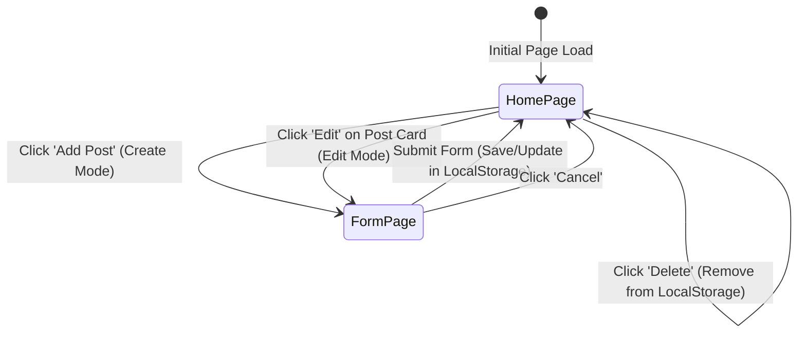

# Practical 03: Basic Blogging Website (Add, View, Edit Posts)

**Course:** BCA (Bachelor of Computer Applications)  
**Subject:** Web Application Development Lab  
**Affiliation:** Maharshi Dayanand University (MDU Rohtak)  

---

## 1. Objective
To build a functional Single Page Blogging Application (SPA) with features to create, view, edit, and delete blog posts using vanilla JavaScript, HTML5, CSS3, and persistent browser Local Storage.

---

## 2. Theoretical Background
Single Page Applications (SPAs) deliver a desktop-like responsiveness by dynamically rewriting the existing web page with new data from user interactions rather than reloading entire pages from a server.

### Key Concepts Applied:
1. **HTML5 Web Storage API (`localStorage`):** Enables client-side data persistence across browser sessions without cookies or network latency.
2. **State Management & Routing:** Managing view states (`homePage` vs `formPage`) using CSS classes (`hidden`) without page refreshes.
3. **Data Sanitization & XSS Prevention:** Dynamic element construction using `document.createElement()` and `textContent` rather than `innerHTML` to avoid Cross-Site Scripting (XSS) vulnerabilities.

---

## 3. Architecture & Data Flow



---

## 4. File Structure
```
Program-3/
├── index.html       # Single-page layout containing Home and Form views
├── style.css        # Clean blog styling with modern card typography
├── script.js        # CRUD operations, LocalStorage controller & view router
└── README.md        # Comprehensive academic documentation
```

---

## 5. Implementation Walkthrough

### 1. Persistent Storage Methods
```javascript
// LocalStorage operations
function getPosts() {
    return JSON.parse(localStorage.getItem(STORAGE_KEY)) || [];
}
function savePosts(posts) {
    localStorage.setItem(STORAGE_KEY, JSON.stringify(posts));
}
```

### 2. View Switching Logic
- The application toggles visibility using `classList.add("hidden")` and `classList.remove("hidden")` between `#homePage` and `#formPage`.

### 3. Add & Edit Mode Handling
- If `editingPostId` is `null`, submission generates a new post object with unique ID `Date.now()`.
- If `editingPostId` has an ID, the matching post is located and its properties (`title`, `author`, `content`, `updatedAt`) are updated in-place.

---

## 6. How to Run the Program

1. Open `Program-3` folder in file explorer.
2. Double-click `index.html` to open in any web browser.
3. Add a blog post, inspect it in the feed, edit its content, or delete it.
4. Refresh the browser to verify data persistence via `localStorage`.

---

## 7. Test Cases & Verification

| Test Case | Action | Expected Output | Status |
| :--- | :--- | :--- | :--- |
| **TC-01** | First launch with empty storage | Shows "No blog posts available. Create your first post!" | Pass |
| **TC-02** | Add new post ("Web Dev", "Amit", "BCA Content") | Post appears at top of feed with author and timestamp | Pass |
| **TC-03** | Edit created post title to "Advanced Web Dev" | Feed updates title without creating duplicate post | Pass |
| **TC-04** | Click Delete on post | Card removed from DOM and pruned from LocalStorage | Pass |
| **TC-05** | Browser reload / close and reopen | All saved posts persist reliably | Pass |

---

## 8. Viva Voce Questions & Answers

**Q1: What is the storage limit of HTML5 `localStorage`?**  
*Answer:* Typically around 5MB to 10MB per origin depending on the browser, which is significantly larger than HTTP cookies (limited to 4KB).

**Q2: What is the difference between `localStorage` and `sessionStorage`?**  
*Answer:* Data stored in `localStorage` has no expiration date and persists even when the browser or tab is closed. `sessionStorage` data is cleared automatically when the browser tab or session ends.

**Q3: Why should `textContent` be preferred over `innerHTML` when rendering user-submitted text?**  
*Answer:* `innerHTML` parses input as HTML markup. If user input contains malicious script tags (e.g. `<script>alert('hacked')</script>`), it executes as an XSS attack. `textContent` safely encodes input as plain text literals.
