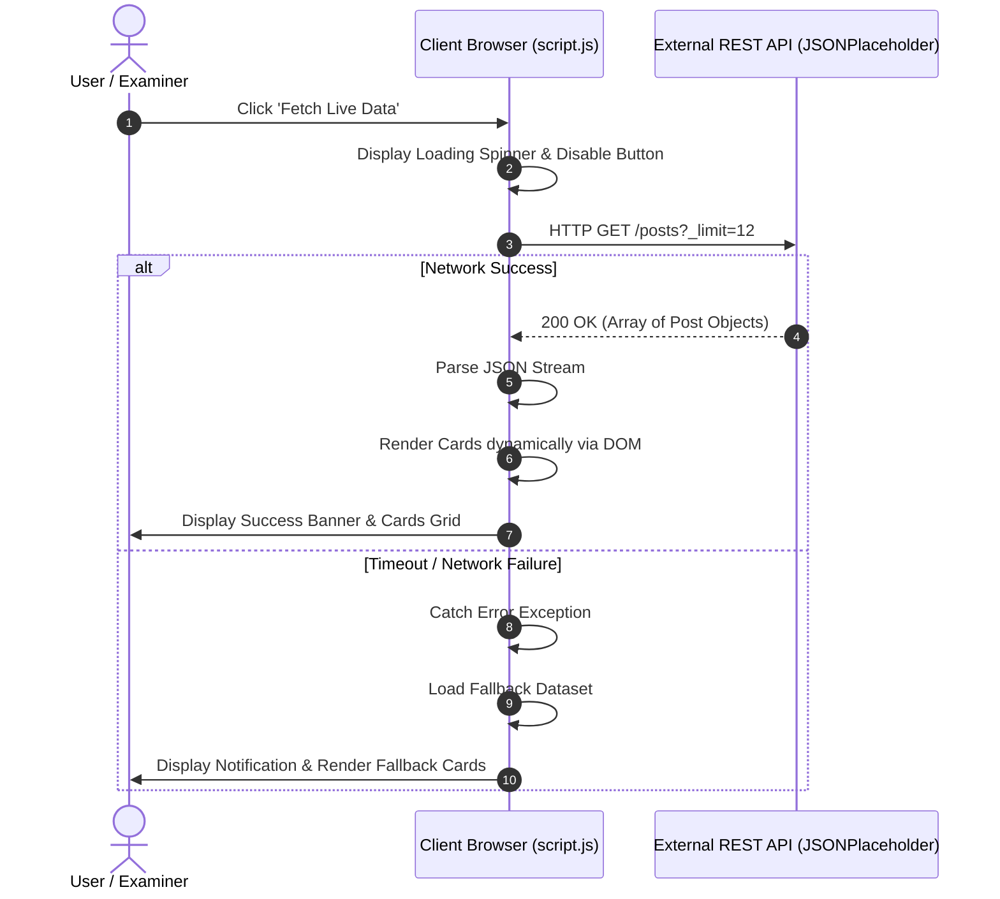

# Practical 04: Dynamically Load Content from External API into Webpage

**Course:** BCA (Bachelor of Computer Applications)  
**Subject:** Web Application Development Lab  
**Affiliation:** Maharshi Dayanand University (MDU Rohtak)  

---

## 1. Objective
To write an asynchronous JavaScript program utilizing the modern `fetch()` API and Promises to dynamically retrieve JSON payloads from an external REST API and dynamically manipulate the Document Object Model (DOM) to present data without reloading the page.

---

## 2. Theoretical Background
In traditional web applications, obtaining new data required full-page reloads. With the introduction of **AJAX (Asynchronous JavaScript and XML)** and modern **Promises / Async-Await**, applications can communicate with remote web services in the background.

### Technologies & Concepts:
- **Fetch API:** Native browser API returning Promises for HTTP communication.
- **AbortController:** Used to enforce network request timeouts, preventing hanging requests.
- **Dynamic DOM Generation:** Utilizes `document.createElement()` and `append()` for safe, performant rendering.
- **Graceful Degradation:** Provides built-in mock fallback data in case of offline conditions or cross-origin network latency.

---

## 3. Architecture & Data Flow



---

## 4. File Structure
```
Program-4/
├── index.html       # UI skeleton with search and dynamic feed container
├── style.css        # Responsive CSS Grid, CSS animations, and badge styling
├── script.js        # Async/await fetch controller, search filter, and DOM builder
└── README.md        # Comprehensive academic lab documentation
```

---

## 5. Implementation Walkthrough

### 1. Fetching External Content with Timeout
```javascript
async function fetchContent() {
    setStatus("loading", "Connecting to external API...");
    const controller = new AbortController();
    const timeoutId = setTimeout(() => controller.abort(), 6000);

    const response = await fetch(API_URL, { signal: controller.signal });
    clearTimeout(timeoutId);
    const data = await response.json();
    renderCards(data);
}
```

### 2. Real-Time Dynamic Search Filtering
The application filters in-memory post objects dynamically upon keyup/input:
```javascript
const filtered = loadedPosts.filter(post => 
    post.title.toLowerCase().includes(query) ||
    post.body.toLowerCase().includes(query)
);
renderCards(filtered);
```

---

## 6. How to Run the Program
1. Navigate to folder `Program-4`.
2. Open `index.html` in your web browser.
3. Observe automatic initial fetching or click **Fetch Live Data**.
4. Test real-time filtering using the search box.

---

## 7. Viva Voce Questions & Answers

**Q1: What is a Promise in JavaScript?**  
*Answer:* A Promise is an object representing the eventual completion or failure of an asynchronous operation and its resulting value. It exists in one of three states: *Pending*, *Fulfilled*, or *Rejected*.

**Q2: What is the main difference between `XMLHttpRequest` and `fetch()`?**  
*Answer:* `XMLHttpRequest` is older, callback-based, and cumbersome to configure. `fetch()` provides a cleaner, Promise-based syntax, supports request/response streaming, and integrates cleanly with modern `async/await`.

**Q3: How does `AbortController` work with `fetch()`?**  
*Answer:* `AbortController` allows aborting one or more Web requests as and when desired. By coupling it with `setTimeout()`, developers can prevent HTTP requests from hanging indefinitely on poor network connections.
