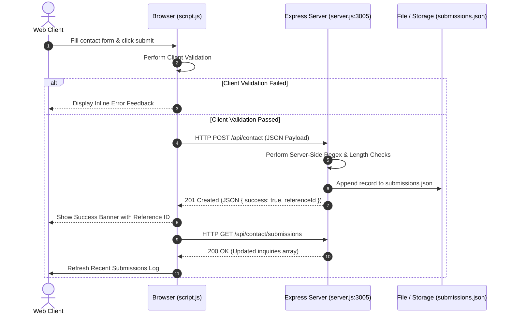

# Practical 05: Contact Form with Backend Server Integration

**Course:** BCA (Bachelor of Computer Applications)  
**Subject:** Web Application Development Lab  
**Affiliation:** Maharshi Dayanand University (MDU Rohtak)  

---

## 1. Objective
To construct a complete full-stack contact inquiry module consisting of an HTML5/CSS3 frontend, client-side input validation, asynchronous transmission of form data using `fetch()` POST, and an Express.js backend server that validates, stores, and logs inquiries.

---

## 2. Theoretical Background
Client-Server architecture separates the presentation layer (User Interface) from the application and data layer. When a user submits an inquiry:
1. **Client Layer:** Validates inputs (presence, email pattern, minimum message length) to minimize bad requests.
2. **Network Transport:** Encapsulates the form fields as a serialized JSON string transmitted via HTTP POST.
3. **Server Layer (Express.js):** Validates the incoming body payload, assigns a unique tracking ID (`INQ-XXXXXX`), and commits the record to persistent storage.

---

## 3. Architecture & Data Flow



---

## 4. File Structure
```
Program-5/
├── public/
│   ├── index.html       # Contact form and submissions log interface
│   ├── style.css        # Clean responsive styling for forms and alerts
│   └── script.js        # Client validation and AJAX fetch handling
├── .env                 # Environment variables (PORT, ADMIN_EMAIL)
├── package.json         # Node.js project manifest & dependencies
├── server.js            # Express server handling /api/contact endpoints
├── submissions.json     # Auto-generated persistent storage
└── README.md            # Comprehensive academic lab documentation
```

---

## 5. API Endpoints Specification

| Method | Endpoint | Description | Request Body | Status Response |
| :--- | :--- | :--- | :--- | :--- |
| `POST` | `/api/contact` | Submits new inquiry | `{ name, email, phone, subject, message }` | `201 Created` or `400 Bad Request` |
| `GET` | `/api/contact/submissions` | Retrieves list of recorded inquiries | None | `200 OK` `{ count, data: [...] }` |

---

## 6. How to Run the Program

### Step 1: Install Dependencies
```bash
cd Program-5
npm install
```

### Step 2: Configure Environment
Edit `.env` (optional, default port is `3005`):
```env
PORT=3005
ADMIN_EMAIL=admin@mdu.ac.in
```

### Step 3: Start the Backend Server
```bash
npm start
```

### Step 4: Access in Browser
Open `http://localhost:3005` in your browser. Fill in the form and test submissions.

---

## 7. Viva Voce Questions & Answers

**Q1: Why is double validation (client-side and server-side) necessary?**  
*Answer:* Client-side validation improves user experience by delivering instant feedback. Server-side validation guarantees data integrity and security because client scripts can be bypassed or manipulated.

**Q2: What is the purpose of CORS (`cors` middleware) in Node.js?**  
*Answer:* Cross-Origin Resource Sharing (CORS) is a security mechanism that allows or restricts resources on a web server from being requested by another domain outside the domain from which the resource originated.

**Q3: Why send data as `application/json` instead of default form `application/x-www-form-urlencoded`?**  
*Answer:* JSON supports nested data structures, arrays, and standard data types (numbers, booleans), making it the standard format for modern RESTful APIs.
