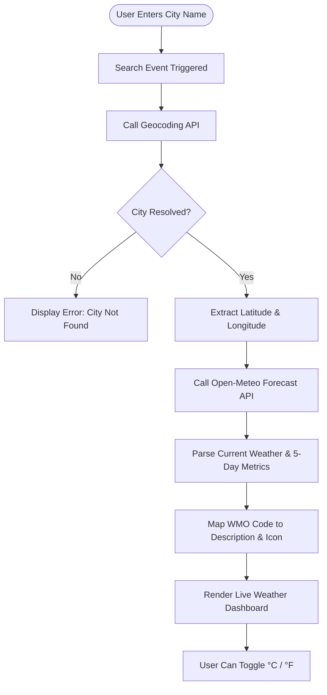

# Practical 06: Weather Application with External REST API

**Course:** BCA (Bachelor of Computer Applications)  
**Subject:** Web Application Development Lab  
**Affiliation:** Maharshi Dayanand University (MDU Rohtak)  

---

## 1. Objective
To design and build a responsive weather forecast web application that communicates with external meteorological REST APIs (Open-Meteo Geocoding & Weather Forecast services) via asynchronous JavaScript to present real-time atmospheric conditions and multi-day forecasts.

---

## 2. Theoretical Background
Modern web applications aggregate disparate web services via REST APIs. In this project:
1. **Geocoding API:** Converts textual human geographic names (e.g., "Rohtak", "New Delhi", "London") into GPS latitude and longitude coordinates.
2. **Forecast Weather API:** Uses the resolved coordinates to return atmospheric measurements:
   - Ambient temperature and apparent temperature ("feels like").
   - Relative humidity percentage and wind velocity.
   - WMO (World Meteorological Organization) weather interpretation codes.
3. **Data Transformation & Unit Conversion:** Implements conversion algorithms between Celsius and Fahrenheit:
   $$F = (C \times \frac{9}{5}) + 32$$

---

## 3. Architecture & Data Flow



---

## 4. File Structure
```
Program-6/
├── index.html       # Semantic layout with search bar, metrics grid, and forecast cards
├── style.css        # Responsive glassmorphic visual presentation with CSS gradients
├── script.js        # Geocoding & Weather API controller, unit conversion, DOM manager
└── README.md        # Comprehensive academic lab documentation
```

---

## 5. Implementation Walkthrough

### 1. Two-Stage Asynchronous Fetching
```javascript
// Step 1: Geocode city name
const geoUrl = `https://geocoding-api.open-meteo.com/v1/search?name=${city}&count=1`;
const geoRes = await fetch(geoUrl);
const { latitude, longitude, name } = (await geoRes.json()).results[0];

// Step 2: Fetch forecast using coordinates
const weatherUrl = `https://api.open-meteo.com/v1/forecast?latitude=${latitude}&longitude=${longitude}&current=temperature_2m...`;
const weatherData = await (await fetch(weatherUrl)).json();
```

### 2. WMO Weather Code Mapping
Standardized WMO codes are mapped to human-readable strings and emoji graphics (e.g. `0 -> "Clear Sky"`, `61 -> "Slight Rain"`, `95 -> "Thunderstorm"`).

---

## 6. How to Run the Program
1. Navigate to the `Program-6` directory.
2. Open `index.html` in any web browser.
3. By default, it queries weather data for Rohtak (home of MDU).
4. Use the input field or quick-city chips to inspect real-time weather globally.
5. Toggle between `°C` and `°F` to test unit conversions.

---

## 7. Viva Voce Questions & Answers

**Q1: Why is Open-Meteo preferred over traditional APIs requiring secret API keys for educational lab setups?**  
*Answer:* Open-Meteo does not require private API keys, avoiding accidental credential leaks on public code repositories (GitHub) and eliminating student registration barriers, while remaining compliant with open scientific datasets.

**Q2: What is Geocoding?**  
*Answer:* Geocoding is the computational process of transforming a postal address or city description into spatial coordinates (latitude and longitude) that geospatial and weather services require.

**Q3: How does client-side unit toggling between Celsius and Fahrenheit work without extra API calls?**  
*Answer:* The raw Celsius values returned by the API are retained in memory. When the user toggles the unit button, client-side JavaScript applies the mathematical conversion formula instantly, avoiding redundant network latency.
