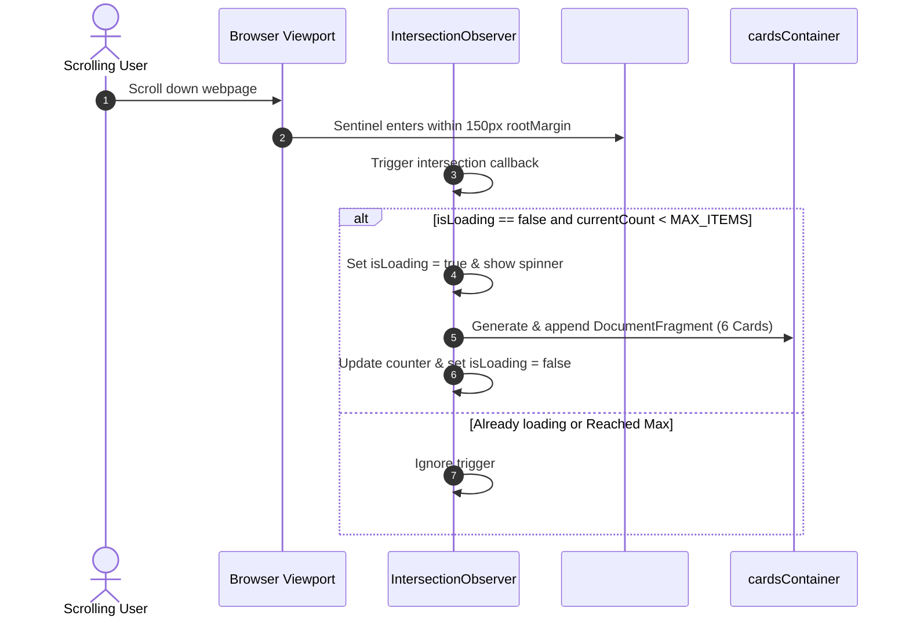

# Practical 07: Infinite Scrolling Webpage with IntersectionObserver

**Course:** BCA (Bachelor of Computer Applications)  
**Subject:** Web Application Development Lab  
**Affiliation:** Maharshi Dayanand University (MDU Rohtak)  

---

## 1. Objective
To implement an infinite scrolling pattern using modern JavaScript and the browser's native `IntersectionObserver` API, dynamically appending content chunks into the DOM as the user approaches the bottom of the viewport without degrading main-thread performance.

---

## 2. Theoretical Background
Traditionally, infinite scrolling was achieved by binding callbacks to the window's `scroll` event. Because the scroll event can fire hundreds of times per second, legacy implementations frequently caused **layout thrashing** and dropped animation frames (jank).

### The IntersectionObserver Solution:
The `IntersectionObserver` interface asynchronously observes changes in the intersection of a target element (`sentinel`) with an ancestor element or top-level document's viewport.
- **Asynchronous Execution:** Runs off the main thread; does not block user interactions.
- **`rootMargin`:** Configured with positive margins (e.g. `150px`) to trigger prefetching *before* the user actually hits the bottom, guaranteeing an uninterrupted reading flow.
- **State Guarding:** Employs an `isLoading` lock variable to prevent duplicate requests from firing while a network payload is in transit.

---

## 3. Architecture & Data Flow



---

## 4. File Structure
```
Program-7/
├── index.html       # Feed structure, sentinel marker, and back-to-top button
├── style.css        # Responsive card layout, spinners, and floating action button
├── script.js        # IntersectionObserver setup, DOM fragment generator, state lock
└── README.md        # Comprehensive academic lab documentation
```

---

## 5. Implementation Walkthrough

### 1. Configuring IntersectionObserver
```javascript
const observer = new IntersectionObserver((entries) => {
    entries.forEach(entry => {
        if (entry.isIntersecting && !isLoading && currentCount < MAX_ITEMS) {
            loadMoreItems();
        }
    });
}, {
    root: null,
    rootMargin: "150px", // Trigger 150px before end
    threshold: 0.1
});

observer.observe(sentinel);
```

### 2. DocumentFragment for Batch Rendering
Rather than mutating the DOM tree 6 times in a loop, a `DocumentFragment` is populated offscreen and appended in a single reflow/repaint operation:
```javascript
const fragment = document.createDocumentFragment();
for (let i = 1; i <= itemsToLoad; i++) {
    fragment.appendChild(createCard(currentCount));
}
cardsContainer.appendChild(fragment);
```

---

## 6. How to Run the Program
1. Navigate to `Program-7`.
2. Open `index.html` in your web browser.
3. Scroll down naturally to observe new cards loading with smooth spinner feedback.
4. Click the floating **⬆️** button to smoothly return to top.
5. Click **Reset Feed** to clear and re-initialize the observer stream.

---

## 7. Viva Voce Questions & Answers

**Q1: Why is `IntersectionObserver` preferred over `window.addEventListener('scroll', ...)`?**  
*Answer:* The `scroll` event fires synchronously on the main UI thread on every single pixel movement, which can cause severe CPU bottlenecks and UI lag. `IntersectionObserver` is handled asynchronously by the browser's internal compositor thread.

**Q2: What is the purpose of `DocumentFragment`?**  
*Answer:* A `DocumentFragment` is a lightweight, minimal document object that exists solely in memory. Appending child elements to a fragment does not trigger browser reflows; appending the fragment to the DOM triggers only a single reflow for all elements combined.

**Q3: How do you prevent infinite requests when a user scrolls very fast?**  
*Answer:* By implementing a boolean state flag (`isLoading = true`) during active processing and releasing it (`isLoading = false`) only when the new elements have finished rendering.
