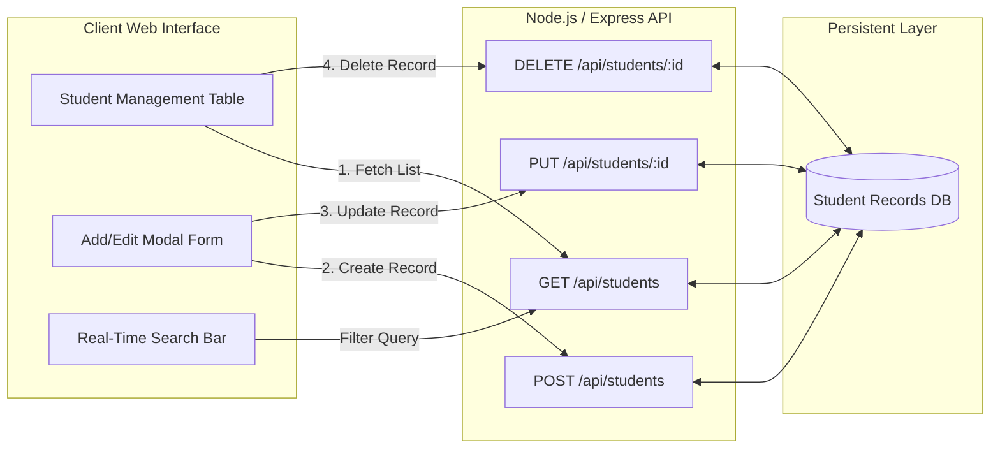

# Practical 08: CRUD Web Application with Database Integration

**Course:** BCA (Bachelor of Computer Applications)  
**Subject:** Web Application Development Lab  
**Affiliation:** Maharshi Dayanand University (MDU Rohtak)  

---

## 1. Objective
To design and develop a full-stack Student Academic Record Management Web Application implementing all four fundamental database operations: **Create**, **Read**, **Update**, and **Delete (CRUD)** using Node.js, Express, a relational database layer, and an asynchronous JavaScript client.

---

## 2. Theoretical Background
**CRUD** represents the four foundational operations of persistent storage:
1. **Create (`POST`):** Inserts new entity records with validation and unique identifier assignment.
2. **Read (`GET`):** Queries and streams entity sets or individual entities, supporting search filters and sorting.
3. **Update (`PUT`):** Modifies existing resource attributes while enforcing data integrity constraints.
4. **Delete (`DELETE`):** Purges entity records from persistent storage upon user authorization.

### Data Integrity Constraints Implemented:
- **Unique Roll Number:** Ensures no duplicate student registration.
- **Unique Email:** Prevents multiple records with identical communication addresses.
- **CGPA Range:** Numerical validation bounding values strictly between `0.00` and `10.00`.

---

## 3. Architecture & Data Flow



---

## 4. File Structure
```
Program-8/
├── database/
│   ├── schema.sql       # SQL table schema with seed values
│   └── records.json     # Embedded persistent database storage
├── public/
│   ├── index.html       # Management interface with data table & modal
│   ├── style.css        # Clean responsive styles and table layout
│   └── script.js        # CRUD fetch controllers and modal handlers
├── .env                 # Environment variables (PORT, DB_TYPE)
├── package.json         # Node.js project manifest & dependencies
├── server.js            # Express REST API for CRUD endpoints
└── README.md            # Comprehensive academic lab documentation
```

---

## 5. REST API Endpoints Specification

| Method | Endpoint | Description | Status Codes |
| :--- | :--- | :--- | :--- |
| `GET` | `/api/students` | Retrieve all student records (supports `?q=search`) | `200 OK` |
| `GET` | `/api/students/:id` | Retrieve single student by ID | `200 OK`, `404 Not Found` |
| `POST` | `/api/students` | Insert new student record | `201 Created`, `400 Bad Request`, `409 Conflict` |
| `PUT` | `/api/students/:id` | Update existing student record | `200 OK`, `404 Not Found`, `409 Conflict` |
| `DELETE` | `/api/students/:id` | Delete student record | `200 OK`, `404 Not Found` |

---

## 6. How to Run the Program

### Step 1: Install Dependencies
```bash
cd Program-8
npm install
```

### Step 2: Configure Environment
Edit `.env` (default port is `3008`):
```env
PORT=3008
DB_TYPE=sqlite
```

### Step 3: Start the Backend Server
```bash
npm start
```

### Step 4: Access in Browser
Navigate to `http://localhost:3008` to manage records in the interactive UI.

---

## 7. Viva Voce Questions & Answers

**Q1: What is the difference between HTTP `PUT` and `PATCH` methods?**  
*Answer:* `PUT` is idempotent and replaces the entire target resource with the uploaded payload. `PATCH` is designed to apply partial modifications to a resource without replacing untouched attributes.

**Q2: What is Idempotency in HTTP REST APIs?**  
*Answer:* An HTTP method is idempotent if the side-effects of making multiple identical requests are the same as making a single request. `GET`, `PUT`, and `DELETE` are idempotent; `POST` is not idempotent (repeated calls create multiple duplicate records).

**Q3: How is data consistency maintained during simultaneous update operations?**  
*Answer:* Through database transactions, locking mechanisms (pessimistic or optimistic concurrency control via version numbers), and atomic operations supported by database management systems.
