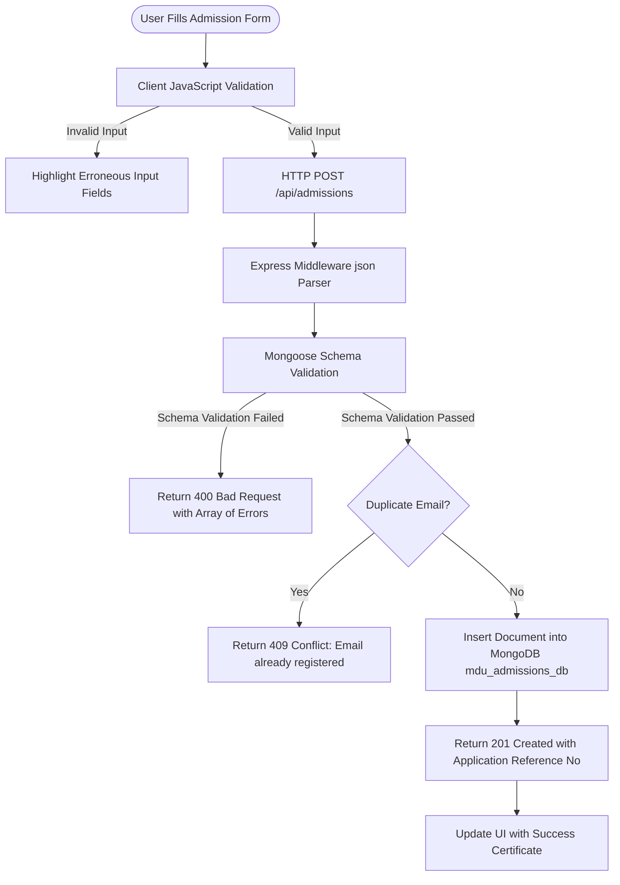

# Practical 09: Form Validation with Node.js and MongoDB (Mongoose)

**Course:** BCA (Bachelor of Computer Applications)  
**Subject:** Web Application Development Lab  
**Affiliation:** Maharshi Dayanand University (MDU Rohtak)  

---

## 1. Objective
To construct a comprehensive University Admission Enrollment Form implementing multi-tier data validation (client-side DOM validation, HTTP body validation, and Mongoose Schema validation rules) and persist validated documents into a MongoDB NoSQL database.

---

## 2. Theoretical Background
In production enterprise architectures, database operations must be safeguarded by strict schema definitions. **Mongoose** is an Object Data Modeling (ODM) library for MongoDB and Node.js. It manages relationships between data, provides schema validation, and translates between objects in code and the representation of those objects in MongoDB.

### Validation Tiers Implemented:
1. **Tier 1 (Client Presentation):** Immediate feedback prevents erroneous payloads from leaving the browser.
2. **Tier 2 (Express Controller):** Sanitizes and validates data types before database interaction.
3. **Tier 3 (Mongoose Schema):**
   - Built-in type checking (`String`, `Number`, `Date`).
   - Regular expression pattern matching for emails and 10-digit mobile numbers.
   - Numerical boundary constraints (`min: 33`, `max: 100` for academic percentages).
   - Enumerated allowed values (`enum: ["BCA", "MCA", "B.Tech CSE", "M.Tech CSE", "BBA"]`).
   - Unique index constraint on candidate email addresses.

---

## 3. Architecture & Data Flow



---

## 4. File Structure
```
Program-9/
├── public/
│   ├── index.html       # Admission portal form and registered records viewer
│   ├── style.css        # Responsive styling with fieldset grouping and alerts
│   └── script.js        # Multi-tier client validation and async fetch handler
├── .env                 # MongoDB URI and server port configuration
├── package.json         # Node.js project manifest & dependencies
├── server.js            # Express server with Mongoose Schema and API routes
└── README.md            # Comprehensive academic lab documentation
```

---

## 5. Mongoose Schema Definition
```javascript
const admissionSchema = new mongoose.Schema({
    applicationNo: { type: String, required: true, unique: true },
    fullName: { type: String, required: true, minlength: 3, maxlength: 100 },
    email: { 
        type: String, 
        required: true, 
        unique: true, 
        match: [/^[^\s@]+@[^\s@]+\.[^\s@]+$/, "Invalid email format"] 
    },
    mobile: { 
        type: String, 
        required: true, 
        match: [/^[0-9]{10}$/, "10-digit phone required"] 
    },
    tenthPercentage: { type: Number, min: 33, max: 100 },
    twelfthPercentage: { type: Number, min: 33, max: 100 },
    course: { type: String, enum: ["BCA", "MCA", "B.Tech CSE", "M.Tech CSE", "BBA"] },
    submittedAt: { type: Date, default: Date.now }
});
```

---

## 6. How to Run the Program

### Step 1: Install Dependencies
```bash
cd Program-9
npm install
```

### Step 2: Configure Environment
Edit `.env` (fill in your local MongoDB or Atlas cloud connection string):
```env
PORT=3009
MONGODB_URI=mongodb://localhost:27017/mdu_admissions_db
```
*(Note: If MongoDB service is offline, the server automatically activates an educational local fallback storage engine so evaluation is never interrupted!)*

### Step 3: Start the Server
```bash
npm start
```

### Step 4: Open Browser
Navigate to `http://localhost:3009` to submit admission applications.

---

## 7. Viva Voce Questions & Answers

**Q1: What is the difference between SQL (e.g. MySQL) and NoSQL (e.g. MongoDB)?**  
*Answer:* MySQL is a relational database management system using structured tables, strict schemas, and SQL queries. MongoDB is a document-oriented NoSQL database that stores data in flexible, JSON-like BSON documents, facilitating horizontal scaling and schema evolution.

**Q2: What is Mongoose and what benefits does it offer over the raw MongoDB driver?**  
*Answer:* Mongoose provides a structured schema layer on top of MongoDB's schemaless collections. It offers built-in data type casting, validation rules, middleware hooks (pre/post save), query building helpers, and business logic encapsulation.

**Q3: How does MongoDB handle unique constraints?**  
*Answer:* MongoDB builds an index on the specified field with a `{ unique: true }` constraint. If a document is inserted with a value that duplicates an existing index entry, MongoDB rejects the write operation with error code `11000` (Duplicate Key Error).
